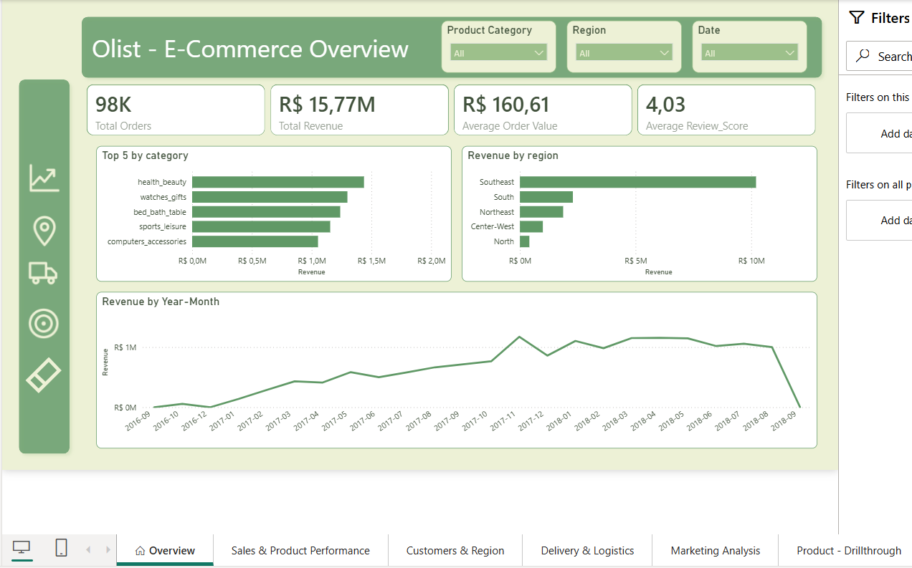

# Olist E-Commerce Analytics – Power BI

An interactive Power BI report on ~98,000 orders from the Brazilian marketplace Olist (2016–2018), covering sales, customers, delivery performance and marketing leads.

## Guiding question
> Where does Olist win customers, where does it lose them, and which marketing leads are actually worth investing in?

## Report pages
| Page | Focus |
|---|---|
| Overview | Orders, revenue, average order value, review score, top categories, regions, monthly trend |
| Sales & Product Performance | Revenue and categories |
| Customers & Region | Customer distribution and regional revenue |
| Delivery & Logistics | Delivery times, late orders, impact on reviews |
| Marketing Analysis | Lead origin, seller scoring model (max. 9 points) |
| Product – Drillthrough | Product-level detail |

## Key findings
- **Southeast dominates:** about 67% of total revenue comes from this region.
- **Retention is the gap:** roughly 97% of customers order only once.
- **Late delivery hurts reviews:** orders delivered 7+ days late get the lowest average review score (1.72 vs. 4.12–4.23 for early deliveries).
- **Best lead channels:** organic and paid search convert most effectively, but many leads have no known origin.

## Files
- `report/` – the Power BI file (`.pbix`)
- `presentation/` – project presentation (English and German)
- `images/` – report screenshots

## Tools
Power BI · DAX · Power Query · Data modeling

## Data
[Brazilian E-Commerce Public Dataset by Olist (Kaggle)](https://www.kaggle.com/datasets/olistbr/brazilian-ecommerce) and the [Marketing Funnel dataset](https://www.kaggle.com/datasets/olistbr/marketing-funnel-olist). Raw CSVs are not included; download them from Kaggle (non-commercial licence).

## Author
Alexander Vasilopoulos
